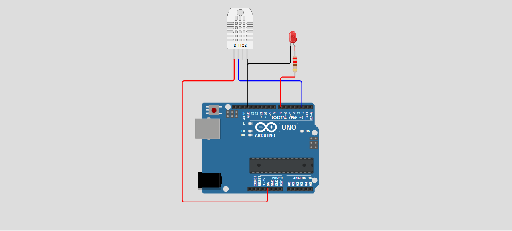
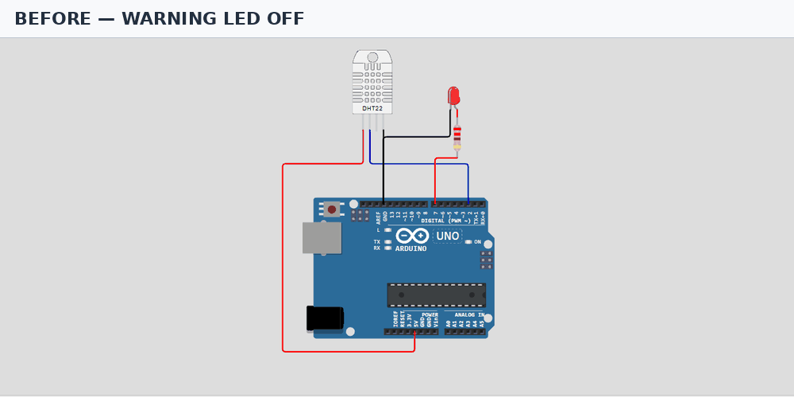
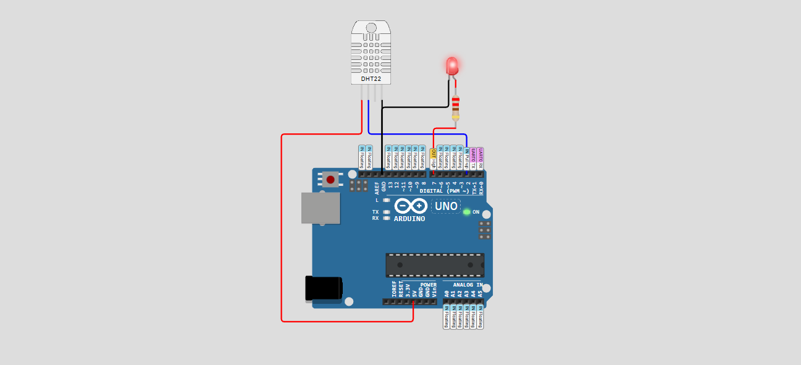

# AUTOSAR-Inspired Embedded Application

## 1. Project Overview

This project demonstrates a layered embedded sensor-monitoring application built around an **Arduino Uno**, a **DHT22 temperature/humidity sensor**, and a **red warning LED**. The application samples the sensor periodically, reports measurements to the Serial Monitor, and turns on the warning LED when the measured temperature is **30.0 °C or higher**. Its modules are organized to illustrate ideas associated with the AUTOSAR Classic Platform, including a separation between application logic, an RTE-style interface, and hardware-facing drivers.

**Scope note:** This is an educational, AUTOSAR-inspired architecture, not an AUTOSAR-compliant implementation. It does not use an AUTOSAR toolchain, generated RTE, ARXML configuration, or the full AUTOSAR Basic Software stack.

## 2. Project Objectives

- Read temperature and relative humidity from a DHT22 sensor.
- Evaluate the temperature against a configurable warning threshold of 30.0 °C.
- Control an LED to communicate the warning state.
- Print sensor readings and warning status over serial at 115200 baud.
- Demonstrate modular C++ organization with driver, RTE-style, and application modules.
- Record observed behavior and provide circuit and demonstration evidence suitable for a project portfolio.

## 3. Components and Tools

| Component / tool | Purpose |
|---|---|
| Arduino Uno | Runs the application logic |
| DHT22 sensor | Measures temperature and relative humidity |
| Red LED | Indicates an over-temperature warning |
| 220 Ω resistor | Limits LED current |
| Arduino IDE or Wokwi | Source editing, compilation, and simulation |
| DHT sensor library by Adafruit | Interfaces with the DHT22 |
| Adafruit Unified Sensor | Supporting sensor library dependency |
| Serial Monitor | Displays measurements and warning states |

The circuit images supplied with the project are included in `docs/wiring-diagram.png` and `media/circuit.png`.

## 4. System Architecture

The software is separated into three conceptual layers:

1. **Application layer — `SensorMonitor.cpp/.h`:** initializes the system, reads sensor values through the RTE-style interface, applies the 30.0 °C threshold, and reports the result.
2. **RTE-style interface — `Rte_SensorMonitor.cpp/.h`:** exposes `Rte_Read_SensorData()` and `Rte_Write_WarningLed()` so the application is decoupled from direct hardware-driver calls.
3. **Hardware-driver layer — `SensorDriver.cpp/.h` and `LedDriver.cpp/.h`:** wraps DHT22 access and LED pin control.
4. **Entry point — `src/sketch.ino`:** initializes serial communication and calls `SensorMonitor_Run()` every 2,000 ms.

**Data flow:** DHT22 → Sensor Driver → RTE-style read interface → Sensor Monitor application → RTE-style write interface → LED Driver → warning LED. Measurements and warning status are also printed to the Serial Monitor.

This is a simplified conceptual mapping for learning; the use of similarly named layers does not make the application compliant with AUTOSAR specifications.

## 5. Circuit Connections

| Device pin | Arduino Uno connection |
|---|---|
| DHT22 VCC | 5V |
| DHT22 DATA | Digital pin D2 |
| DHT22 GND | GND |
| Warning LED anode (long leg) | Digital pin D7 through a 220 Ω series resistor |
| Warning LED cathode (short leg) | GND |

The DHT22 driver is configured for pin D2 and the LED driver for pin D7. Follow the relevant sensor/module datasheet when assembling physical hardware; some DHT22 modules include a data pull-up resistor, while a bare sensor may require one. Do not connect the LED directly to an Arduino output without a current-limiting resistor.



## 6. Software Implementation

- `SensorDriver.cpp` initializes the DHT22 and returns temperature/humidity readings. It checks for null output pointers and invalid (`NaN`) sensor readings.
- `LedDriver.cpp` configures D7 as an output and switches the LED on or off.
- `Rte_SensorMonitor.cpp` initializes the drivers and routes data reads and LED commands.
- `SensorMonitor.cpp` implements the application behavior. The warning condition is `temperatureC >= 30.0f`.
- `src/sketch.ino` starts serial output at **115200 baud** and runs the monitor every **2 seconds**.
- If a DHT22 read is invalid, the demo turns the warning LED on and prints a sensor-error message.

The periodic task uses `millis()` rather than a blocking two-second delay, allowing the main loop to remain responsive.

## 7. Testing and Verification

The recorded run reported ten readings: six samples at 24.0 °C, followed by 29.9 °C, 31.0 °C, 35.2 °C, and 25.6 °C. Humidity remained at 40.0% in the supplied log. The warning stayed OFF below the threshold, turned ON for the two readings above 30.0 °C, and returned OFF when the temperature dropped to 25.6 °C. All ten recorded states match the expected threshold behavior.

| Recorded condition | Temperature | Expected warning | Observed warning | Result |
|---|---:|---|---|---|
| Baseline (six consecutive readings) | 24.0 °C | OFF | OFF on all six readings | Pass |
| Near threshold, below limit | 29.9 °C | OFF | OFF | Pass |
| Above threshold | 31.0 °C | ON | ON | Pass |
| Higher temperature | 35.2 °C | ON | ON | Pass |
| Temperature falls below limit | 25.6 °C | OFF | OFF | Pass |

See [`docs/test-results.md`](docs/test-results.md) for the full supplied serial log, test interpretation, and screenshot notes. The provided run did **not** include an exact 30.0 °C reading or an invalid-sensor test, so those cases remain unverified by the recorded results.

## 8. How to Run the Simulation

1. Open [Wokwi](https://wokwi.com/) and create an Arduino Uno project, or open the project in the Arduino IDE.
2. Add an Arduino Uno, DHT22 sensor, red LED, and 220 Ω resistor.
3. Wire the components using the table in section **e. Circuit Connections** and the diagram in `docs/wiring-diagram.png`.
4. Add the `.cpp` and `.h` files from the project root to the simulation/project.
5. Copy the contents of `src/sketch.ino` into the root `sketch.ino` used by the Arduino IDE/Wokwi project. The requested portfolio layout stores the sketch in `src/`, while standard Arduino/Wokwi sketches commonly expect their entry-point `.ino` at the sketch root.
6. Install the libraries listed in `libraries.txt` (DHT sensor library by Adafruit and Adafruit Unified Sensor).
7. Start the simulation and open the Serial Monitor at **115200 baud**.
8. Change the DHT22 temperature while the simulation is running. Verify that the LED is OFF below 30.0 °C and ON at or above 30.0 °C. The supplied results demonstrate several values on either side of the threshold, but do not include a recorded measurement at exactly 30.0 °C.

## 9. Project Structure

```text
AUTOSAR-Inspired-Embedded-Application/
├── LedDriver.cpp
├── LedDriver.h
├── Rte_SensorMonitor.cpp
├── Rte_SensorMonitor.h
├── SensorDriver.cpp
├── SensorDriver.h
├── SensorMonitor.cpp
├── SensorMonitor.h
├── libraries.txt
├── README.md
├── src/
│   └── sketch.ino
├── docs/
│   ├── wiring-diagram.png
│   ├── test-results.md
│   └── system-description.md
└── media/
    ├── circuit.png
    └── demo.gif
```

## 10. Skills Demonstrated

- Embedded C++ programming for Arduino
- Sensor interfacing and handling invalid sensor readings
- Digital output control and LED status indication
- Periodic task scheduling with `millis()`
- Modular software design and separation of concerns
- AUTOSAR-inspired application/RTE/driver layering concepts
- Serial diagnostics and threshold-based decision logic
- Simulation-based testing, results documentation, and portfolio presentation

## 11. Limitations and Future Improvements

- The architecture is educational and is **not AUTOSAR-compliant**.
- The recorded test run uses 40.0% humidity for each sample and does not verify humidity boundary cases.
- An exact 30.0 °C sample and invalid/disconnected sensor behavior still need dedicated recorded tests.
- The current response to an invalid DHT22 reading is to turn the warning LED on; a production design would define a more explicit diagnostic/fail-safe strategy.
- Future improvements could include configurable thresholds, unit tests, sensor fault diagnostics, hysteresis to reduce rapid switching near the threshold, an RTOS task, and a documented test plan with repeatable boundary tests.
- A production automotive implementation would require an appropriate target platform, safety/security analysis where applicable, formal interfaces/configuration, and the required AUTOSAR development toolchain and validation process.

## 12. Demonstration

The animation alternates between the supplied circuit screenshots showing the warning LED visually OFF and ON. The measurement values and observed state changes are documented in `docs/test-results.md`.





No public Wokwi simulation URL was included in the supplied materials. Add the project URL here after publishing the simulation.

## 13. Author

**Ahmed Abbas**

Mechatronics Engineering | Embedded Systems | Automotive Engineering

GitHub: https://github.com/abbasahmed494-coder
LinkedIn: https://www.linkedin.com/in/ahmed-abbas-7a7b04221/
